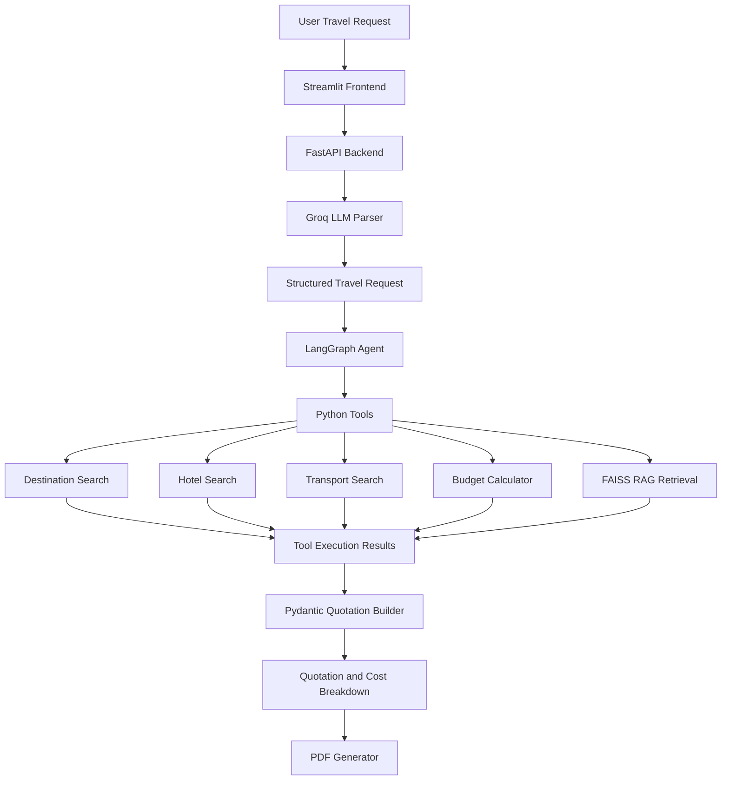

# TravelOps AI ✈️

**An agentic AI travel planning and quotation system powered by Groq, LangGraph, FAISS RAG, FastAPI and Streamlit.**

TravelOps AI converts natural-language travel requests into structured travel quotations. It combines LLM-powered request extraction, tool-calling agents, retrieval-augmented generation (RAG), deterministic Python calculations and PDF generation.

## Features

- **Natural-language understanding:** Extracts destination, duration, travelers, origin, budget and hotel preferences using Groq.
- **Agentic orchestration:** Uses LangGraph to coordinate an AI agent and its tools.
- **Tool calling:** Searches destinations, hotels, transport estimates and travel knowledge.
- **RAG with FAISS:** Retrieves relevant information from a curated travel knowledge base.
- **Deterministic budget calculation:** Calculates accommodation, transport, food, activities and local transport costs using Python.
- **Structured quotations:** Produces validated quotation objects using Pydantic.
- **PDF generation:** Generates downloadable travel quotation PDFs.
- **REST API:** Exposes travel parsing and quotation generation through FastAPI.
- **Interactive frontend:** Provides a Streamlit interface for submitting travel requests and viewing results.

## Architecture



## Technology Stack

| Component | Technologies |
|---|---|
| Language | Python |
| LLM | Groq API, GPT-OSS-20B |
| Agent orchestration | LangGraph |
| Backend | FastAPI |
| Frontend | Streamlit |
| RAG | FAISS, Sentence Transformers |
| Embeddings | all-MiniLM-L6-v2 |
| Validation | Pydantic |
| PDF generation | ReportLab |
| Testing | Pytest |

## Project Structure

```text
travelops-ai/
│
├── backend/
│   ├── agents/
│   │   ├── langgraph_agent.py
│   │   ├── tool_definitions.py
│   │   ├── tool_executor.py
│   │   └── travel_agent.py
│   │
│   ├── data/
│   │   └── destinations.json
│   │
│   ├── rag/
│   │   ├── documents/
│   │   ├── vectorstore/
│   │   ├── ingest.py
│   │   └── retriever.py
│   │
│   ├── schemas/
│   ├── services/
│   ├── tools/
│   └── main.py
│
├── frontend/
│   └── app.py
│
├── tests/
│   └── test_tools.py
│
├── reports/
├── .env.example
├── .gitignore
├── pytest.ini
└── requirements.txt
```

## Getting Started

### 1. Clone the repository

```bash
git clone https://github.com/YOUR_USERNAME/travelops-ai.git
cd travelops-ai
```

### 2. Create a virtual environment

```bash
python -m venv .venv
```

Activate it on Windows:

```powershell
.\.venv\Scripts\Activate.ps1
```

### 3. Install dependencies

```bash
python -m pip install --upgrade pip
pip install -r requirements.txt
```

### 4. Configure environment variables

Create a `.env` file in the project root:

```env
GROQ_API_KEY=your_groq_api_key
GROQ_MODEL=openai/gpt-oss-20b
```

Obtain your API key from the Groq developer console.

Never commit your `.env` file or expose API keys publicly.

### 5. Run the FastAPI backend

```bash
python -m uvicorn backend.main:app --reload
```

API documentation:

`http://127.0.0.1:8000/docs`

### 6. Run the Streamlit frontend

Open another terminal, activate the virtual environment and run:

```bash
streamlit run frontend/app.py
```

Frontend:

`http://localhost:8501`

## API Endpoints

### Health Check

`GET /health`

Checks whether the backend is running.

### Parse Travel Request

`POST /api/parse-travel-request`

Example:

```json
{
  "message": "Plan a 5-day trip to Goa for 2 people from Bhubaneswar with a budget of 40000 INR."
}
```

### Generate Travel Quotation

`POST /api/generate-quotation`

Example:

```json
{
  "message": "Plan a 5-day trip to Goa for 2 people from Bhubaneswar with a budget of 40000 INR. I prefer comfortable hotels."
}
```

Returns a structured quotation, cost breakdown and agent execution log.

## Example Output

For the illustrative Goa dataset:

| Expense | Estimated Cost |
|---|---:|
| Accommodation | ₹10,000 |
| Transport | ₹13,000 |
| Food | ₹5,000 |
| Activities | ₹2,500 |
| Local transport | ₹3,000 |
| **Total** | **₹33,500** |

- Travelers: 2
- Duration: 5 days
- Budget: ₹40,000
- Cost per person: ₹16,750
- Remaining budget: ₹6,500

## Testing

Run the test suite:

```bash
pytest -v
```

The current unit tests cover destination search, hotel search, transport search, budget calculations and input validation.

## Engineering Highlights

- Separated LLM reasoning from deterministic financial calculations.
- Used a tool registry to control which Python functions the agent can execute.
- Implemented a LangGraph agent-tool execution loop.
- Integrated FAISS retrieval for travel knowledge and policy context.
- Used structured Pydantic models for validated quotation output.
- Added unit tests for core business logic.

## Limitations

- The current destination, hotel and transport information comes from a curated demonstration dataset.
- Prices are illustrative estimates, not live supplier quotations.
- Hotel, flight, transport and attraction availability is not verified.
- The current dataset is limited and should not be treated as a production travel inventory.

## Future Improvements

- Integrate live flight, hotel and transport APIs.
- Expand destination coverage and travel knowledge sources.
- Add user authentication and saved itineraries.
- Implement agent evaluation and retrieval-quality metrics.
- Add deployment, monitoring and observability.
- Support additional currencies and destinations.

---

**Built as an applied AI engineering project exploring LLM agents, tool calling, RAG, API development and deterministic business logic.**